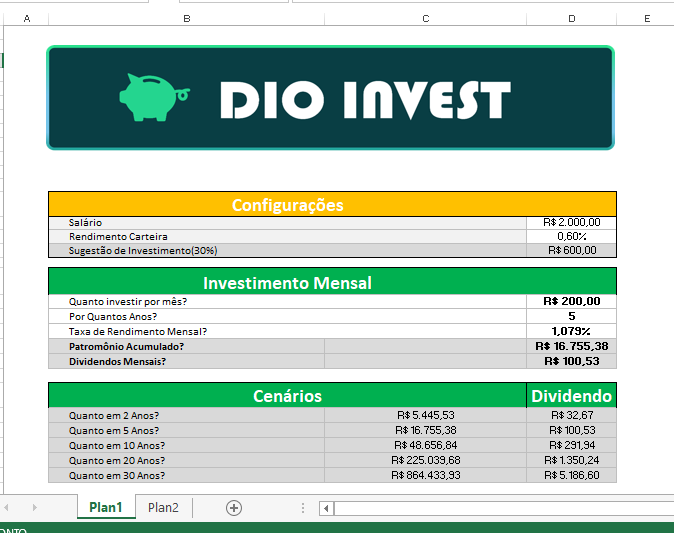
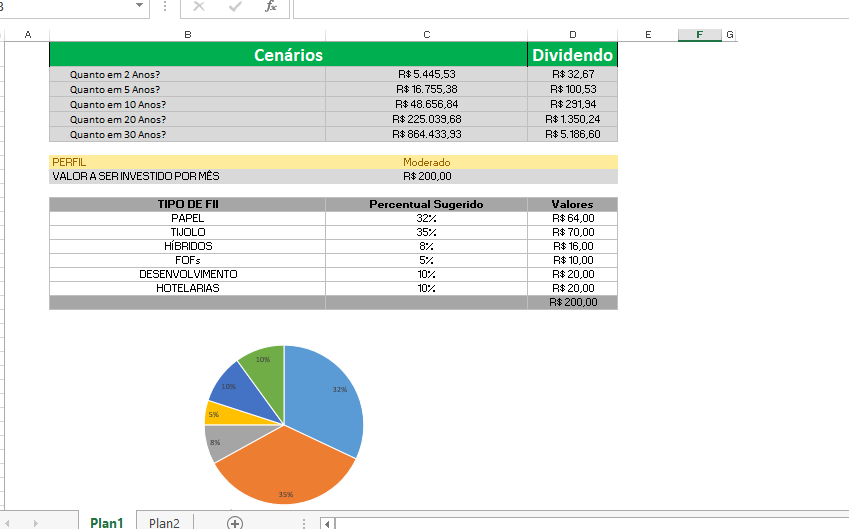

# 💰 DIO Invest - Ferramenta de Controle de Investimentos com Excel

Projeto prático desenvolvido durante a formação na [DIO (Digital Innovation One)](https://dio.me), com o objetivo de construir um dashboard interativo para controle financeiro, simulação de patrimônio a longo prazo e recomendação de alocação de carteira de investimentos.

---

## 📸 Demonstração do Projeto

---

## 🎯 Objetivos da Ferramenta

- **Planejamento Financeiro:** Cálculo de sugestão de investimento mensal baseado na renda informada.
- **Simulação com Juros Compostos:** Projeção do patrimônio acumulado ao longo dos anos a partir de aportes mensais recorrentes.
- **Estratégia de Alocação de Ativos:** Sugestão de distribuição percentual e financeira em Fundos de Investimento Imobiliário (FIIs) conforme o perfil de risco do investidor.
- **Visual Executivo (Dashboard):** Apresentação limpa e moderna sem linhas de grade, facilitando a tomada de decisão visual através de gráficos.

---

## ⚙️ Funcionalidades e Fórmulas Utilizadas

1. **Cálculo de Projeção Financeira (`VF`):**
   - Utilização da função de **Valor Futuro (`VF`)** do Excel para calcular o montante acumulado considerando aportes mensais, prazo em anos e taxa de rendimento estimada.
2. **Matriz de Alocação com Busca Dinâmica (`PROCV`):**
   - Criação de chaves combinadas (`PERFIL-TIPO DE ATIVO`) em tabela auxiliar.
   - Aplicação da função `PROCV` para buscar automaticamente os percentuais de alocação de cada categoria de FII (Papel, Tijolo, Híbridos, FoFs, Desenvolvimento e Hotelaria).
3. **Validação de Dados e Cálculos Automáticos:**
   - Cálculo automático dos valores em R$ a serem alocados por categoria com base no aporte mensal escolhido.
4. **Visualização Gráfica:**
   - Gráfico de setores (pizza/rosca) integrado para demonstrar a proporção de cada ativo na carteira do investidor.

---

## 🛠️ Tecnologias e Ferramentas

- **Microsoft Excel**
- Fórmulas financeiras e de busca (`VF`, `PROCV`, concatenação `&`)
- Formatação de dashboards e gráficos dinâmicos

---

## 👨‍💻 Autor

Projeto desenvolvido como parte dos Desafios de Projeto da **DIO**.
